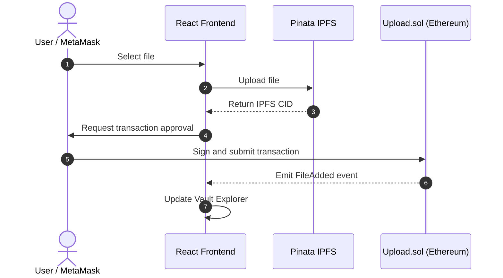

# SecuredVault — Decentralized File Storage and Access Management

**SecuredVault** is a decentralized file storage platform built using Ethereum, IPFS, and React. It enables users to upload files to IPFS, manage file ownership through a Solidity smart contract, and share or revoke access for specific Ethereum addresses.

The platform combines decentralized storage with blockchain-based access management to provide a transparent and user-controlled file-sharing experience.

**Technology Stack:** Solidity, Hardhat, React, Ethers.js, IPFS, Pinata, and MetaMask.

[](https://soliditylang.org/) [](https://hardhat.org/) [](https://react.dev/) [](https://pinata.cloud/) [](https://www.gnu.org/licenses/gpl-3.0)

---

## Key Features

* **Decentralized Storage:** Upload and pin files to IPFS using Pinata.
* **Blockchain-Based Access Control:** Manage file ownership and sharing permissions through a Solidity smart contract.
* **File Sharing:** Grant selected Ethereum addresses permission to access files.
* **Access Revocation:** Revoke previously granted permissions through a blockchain transaction.
* **Vault Explorer:** Browse uploaded files, preview supported images, download files, and access IPFS links.
* **Web3 Integration:** Connect MetaMask to interact with the smart contract and approve transactions.
* **Responsive Interface:** A dark-themed React interface with file uploads and transaction status updates.

## Architecture Overview

The following diagram illustrates the file upload and storage process, including the interaction between the React frontend, Pinata IPFS, MetaMask, and the Ethereum smart contract.



## Prerequisites

Ensure the following are installed or configured before running the project:

1. **Node.js:** Version 18, 20, or 22.
2. **MetaMask:** Browser extension for connecting an Ethereum wallet.
3. **Pinata Account:** Used to upload and pin files on IPFS.
4. **Git:** For cloning and managing the repository.

## Configuration

### 1. Configure Pinata

1. Sign in to the [Pinata Dashboard](https://app.pinata.cloud/).
2. Navigate to [API Keys](https://app.pinata.cloud/developers/api-keys).
3. Create an API key with the required file-pinning permissions.
4. Copy the API credentials and configure the frontend environment variables.

Create the environment file:

```bash
cp client/.env.example client/.env
```

Update `client/.env` with your credentials:

```env
REACT_APP_PINATA_API_KEY=your_pinata_api_key
REACT_APP_PINATA_SECRET_API_KEY=your_pinata_secret_key
REACT_APP_PINATA_GATEWAY=https://gateway.pinata.cloud/ipfs/
```

**Security note:** These environment variables are embedded in a client-side React application and must not contain privileged or administrative API secrets in a deployed production build. Use a backend service to handle authenticated Pinata uploads securely.

### 2. Configure MetaMask

To connect MetaMask to the local Hardhat blockchain, configure the following network:

| Setting         | Value                   |
| --------------- | ----------------------- |
| Network Name    | Hardhat Localhost       |
| RPC URL         | `http://127.0.0.1:8545` |
| Chain ID        | `31337`                 |
| Currency Symbol | `ETH`                   |

Start the local blockchain using the instructions below. Hardhat will display test accounts and their private keys in the terminal.

Import one of these test accounts into MetaMask for local development only.

**Important:** Never use Hardhat test accounts or their private keys on a public network or with real funds.

## Getting Started

### Step 1: Install Dependencies

Run the following commands from the project root:

```bash
npm install
cd client
npm install
cd ..
```

### Step 2: Start the Local Blockchain

Open a terminal and run:

```bash
npx hardhat node
```

Keep the terminal running while developing and testing the application.

### Step 3: Deploy the Smart Contract

Open another terminal in the project root:

```bash
npm run deploy
```

This command deploys the `Upload` smart contract to the local Hardhat network. The deployment script is configured to save the contract address to:

```text
client/src/artifacts/contract-address.json
```

### Step 4: Start the Frontend

Run:

```bash
npm run client
```

Open the application at:

http://localhost:3000

Connect MetaMask to the local network and begin uploading and sharing files.

## Testing

### Smart Contract Tests

Run the Hardhat test suite:

```bash
npm test
```

The tests cover:

* File registration and URL validation.
* Prevention of unauthorized file registration.
* Access permission management.
* Permission revocation.
* Unauthorized file access.
* Shared-access list validation.

The repository includes eight smart contract tests covering these scenarios.

### Frontend Tests

Run the frontend test suite using the configured npm script:

```bash
npm run client:test
```

## Repository Structure

```text
SecuredVault/
├── contracts/
│   └── Upload.sol
├── scripts/
│   └── deploy.js
├── test/
│   └── Upload.test.js
├── client/
│   ├── .env.example
│   ├── public/
│   └── src/
│       ├── artifacts/
│       ├── components/
│       │   ├── FileUpload.js
│       │   ├── Display.js
│       │   └── Modal.js
│       ├── App.js
│       ├── App.css
│       └── index.css
├── hardhat.config.js
└── package.json
```

## Smart Contract Specification

The `Upload.sol` contract manages file references and access permissions.

| Function                                | Description                                                                       |
| --------------------------------------- | --------------------------------------------------------------------------------- |
| `add(address _user, string memory url)` | Registers an IPFS file URL for the calling user's account, validating ownership.  |
| `allow(address user)`                   | Grants another Ethereum address permission to access the caller's files.          |
| `disallow(address user)`                | Revokes previously granted access.                                                |
| `display(address _user)`                | Returns file URLs when the caller has the required access.                        |
| `shareAccess()`                         | Returns the caller's recorded sharing permissions and associated access statuses. |

## Troubleshooting

### 1. MetaMask Transaction Errors

If you encounter a nonce error or a transaction remains pending after restarting the local blockchain:

1. Ensure the Hardhat node is running.
2. Verify that MetaMask is connected to the correct local network.
3. If necessary, use MetaMask's account reset option to clear local transaction history.
4. Refresh the application and retry the transaction.

### 2. Pinata Authentication Errors

If uploads fail with a `401 Unauthorized` error:

* Verify the API credentials and required permissions.
* Check the environment variable names and values.
* Restart the React development server after changing environment variables.
* Ensure the upload endpoint and gateway configuration are correct.

### 3. MetaMask Not Detected

* Install and enable the MetaMask browser extension.
* Unlock the wallet.
* Refresh the application.
* Confirm that the application can access the wallet provider.

## License

This project is licensed under the **GNU General Public License v3.0 (GPL-3.0)**. See the [LICENSE](https://www.gnu.org/licenses/gpl-3.0) for details.
