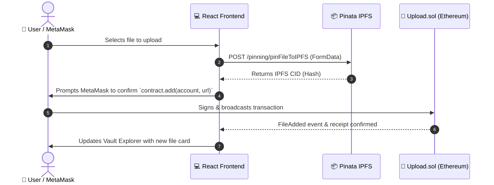

# 🛡️ SecuredVault: Decentralized Web3 File Storage & Access Management

[](https://soliditylang.org/)
[](https://hardhat.org/)
[](https://reactjs.org/)
[](https://pinata.cloud/)
[](https://docs.ethers.org/v5/)
[](https://www.gnu.org/licenses/gpl-3.0)

**SecuredVault** is a decentralized cloud storage platform (Web3 Google Drive) built on **Ethereum** and **IPFS (via Pinata)**. It allows users to upload any type of file permanently to the InterPlanetary File System (IPFS) and govern granular access permissions via a Solidity smart contract.

---

## 🌟 Key Features

- **🌐 Decentralized Storage**: Files are permanently pinned to IPFS using Pinata Cloud, eliminating single points of failure.
- **🔐 On-Chain Access Control**: Cryptographically manages file ownership and access permissions directly on Ethereum.
- **🤝 Granular File Sharing**: Grant view access to specific Ethereum addresses (`allow`) without revealing private keys.
- **🚫 Instant Permission Revocation**: Revoke view access from any address at any time with a single transaction (`disallow`).
- **🖼️ Built-in Vault Explorer**: Interactive grid gallery featuring previews for images, file download triggers, IPFS gateway links, and copyable CIDs.
- **⚡ Reactive Glassmorphic UI**: High-performance dark-mode interface built with React 18, featuring drag-and-drop file upload, real-time transaction status, and network detection.

---

## 🏗️ Architecture Overview



---

## 📋 Prerequisites

Before getting started, make sure you have:

1. **Node.js**: `v18.x`, `v20.x`, or `v22.x` ([Download Node.js](https://nodejs.org/))
2. **MetaMask Extension**: Installed in your browser ([Download MetaMask](https://metamask.io/))
3. **Pinata Account**: Free account for IPFS pinning ([Sign up for Pinata](https://app.pinata.cloud/register))

---

## ⚙️ Configuration Setup

### 1. Pinata IPFS Configuration
To pin files to IPFS, get your API credentials from Pinata:

1. Log into your [Pinata Dashboard](https://app.pinata.cloud/).
2. Navigate to **API Keys** under Developers (`https://app.pinata.cloud/developers/api-keys`).
3. Click **New Key**.
4. Enable **Admin permissions** or ensure `pinFileToIPFS` is checked.
5. Copy your **API Key** and **API Secret**.
6. In the `client/` folder, create a `.env` file (you can copy from `client/.env.example`):

```bash
cp client/.env.example client/.env
```

Open `client/.env` and update the keys:
```env
REACT_APP_PINATA_API_KEY=your_actual_pinata_api_key_here
REACT_APP_PINATA_SECRET_API_KEY=your_actual_pinata_secret_key_here
REACT_APP_PINATA_GATEWAY=https://gateway.pinata.cloud/ipfs/
```

---

### 2. MetaMask Network & Account Setup

When running a local Hardhat blockchain, configure MetaMask as follows:

#### Step A: Add Hardhat Local Network to MetaMask
1. Open the MetaMask extension.
2. Click the **Network selector dropdown** (top left) and click **Add a network manually**.
3. Fill in the network details:
   - **Network Name**: `Hardhat Localhost`
   - **New RPC URL**: `http://127.0.0.1:8545`
   - **Chain ID**: `31337` *(or `1337` if prompted)*
   - **Currency Symbol**: `ETH`
4. Click **Save** and switch to this network.

#### Step B: Import a Pre-Funded Test Account
1. When you run `npx hardhat node` (see below), Hardhat prints 20 test accounts with 10,000 test ETH each.
2. Example Private Key for Account #0:
   ```
   0xac0974bec39a17e36ba4a6b4d238ff944bacb478cbed5efcae784d7bf4f2ff80
   ```
3. In MetaMask, click your **Account icon** -> **Add account or hardware wallet** -> **Import account**.
4. Paste the private key and click **Import**. You will now have 10,000 ETH to test transactions locally!

---

## 🚀 Quickstart: Running Locally

### Step 1: Install Dependencies
Install dependencies for both the Hardhat backend and the React frontend:

```bash
# In the project root directory
npm install

# In the client directory
cd client && npm install && cd ..
```

### Step 2: Start Local Ethereum Node
In your terminal, start the Hardhat local node:

```bash
npx hardhat node
```
*Keep this terminal running. It will output test accounts and act as your local blockchain.*

### Step 3: Deploy Smart Contract
In a **new terminal tab/window**, deploy the `Upload` contract to your local node:

```bash
npm run deploy
```
*This compiles the contract, deploys it to the local chain, and automatically saves the address into `client/src/artifacts/contract-address.json`.*

### Step 4: Start the Frontend Application
Start the React development server:

```bash
npm run client
```
The application will automatically open in your browser at **`http://localhost:3000`**.

---

## 🧪 Running Automated Tests

### Smart Contract Tests
Run Hardhat unit tests to verify contract logic (`add`, `allow`, `disallow`, `display`, `shareAccess`):

```bash
npm test
```
*Outputs:*
```
  Upload Contract
    File Upload (add)
      ✔ Should allow a user to add a file URL for themselves
      ✔ Should revert if URL is empty
      ✔ Should prevent user from adding file to another user's vault
    Access Control (allow & disallow)
      ✔ Should prevent unauthorized users from viewing files
      ✔ Should allow access after calling allow()
      ✔ Should reject allow for self or zero address
      ✔ Should revoke access after calling disallow()
      ✔ Should return correct shareAccess list

  8 passing (2s)
```

### Frontend Tests
Run React testing-library tests:

```bash
npm run client:test
```

---

## 📁 Repository Structure

```text
├── contracts/
│   └── Upload.sol            # Solidity contract (storage & access control)
├── scripts/
│   └── deploy.js             # Deployment script with auto address export
├── test/
│   └── Upload.test.js        # Hardhat Chai test suite (8 tests)
├── client/
│   ├── .env.example          # Template for Pinata & contract env vars
│   ├── public/               # Static assets & HTML template
│   └── src/
│       ├── artifacts/        # Compiled contract ABI & deployed address
│       ├── components/
│       │   ├── FileUpload.js # Pinata IPFS uploader & on-chain recorder
│       │   ├── Display.js    # Vault Explorer & IPFS file viewer
│       │   └── Modal.js      # Share & Access Control management modal
│       ├── App.js            # Main dashboard component with web3 provider
│       ├── App.css           # Modern glassmorphism styling
│       └── index.css         # Typography, design tokens & dark theme
├── hardhat.config.js         # Hardhat network configuration
└── package.json              # Project scripts & devDependencies
```

---

## 📜 Smart Contract Specification (`Upload.sol`)

| Function | Type | Description |
|---|---|---|
| `add(address _user, string memory url)` | `external` | Stores an IPFS file URL for the sender's account. Validates that `_user == msg.sender`. |
| `allow(address user)` | `external` | Grants another Ethereum address permission to read the sender's files. |
| `disallow(address user)` | `external` | Revokes view permission previously granted to an address. |
| `display(address _user)` | `external view` | Returns an array of file URLs for `_user`. Reverts with `"You don't have access"` if unauthorized. |
| `shareAccess()` | `external view` | Returns the list of addresses the caller has interacted with and their current access status. |

---

## 🛠️ Common Troubleshooting

<details>
<summary><strong>1. MetaMask Error: "Nonce too high" or transaction stuck</strong></summary>

When you restart `npx hardhat node`, the local blockchain resets to block 0, but MetaMask remembers past transactions:
1. In MetaMask, go to **Settings** -> **Advanced**.
2. Click **Clear activity and nonce data** (or **Reset Account** in older versions).
3. Refresh the app and submit the transaction again.
</details>

<details>
<summary><strong>2. Pinata Error: "401 Unauthorized" or "Unable to upload file to Pinata"</strong></summary>

- Double-check that your API Key and Secret in `client/.env` do not have trailing spaces or quotes.
- Restart the client server (`npm run client`) after modifying `.env`.
- Ensure your Pinata API key has pinning permissions enabled.
</details>

<details>
<summary><strong>3. "Metamask is not installed" warning in app</strong></summary>

Ensure you are using a browser with the MetaMask extension enabled (Chrome, Brave, Firefox, Edge) and that MetaMask is unlocked.
</details>

---

## 📄 License

This project is licensed under the **GNU General Public License v3.0 (GPL-3.0)**.
